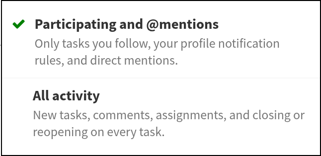
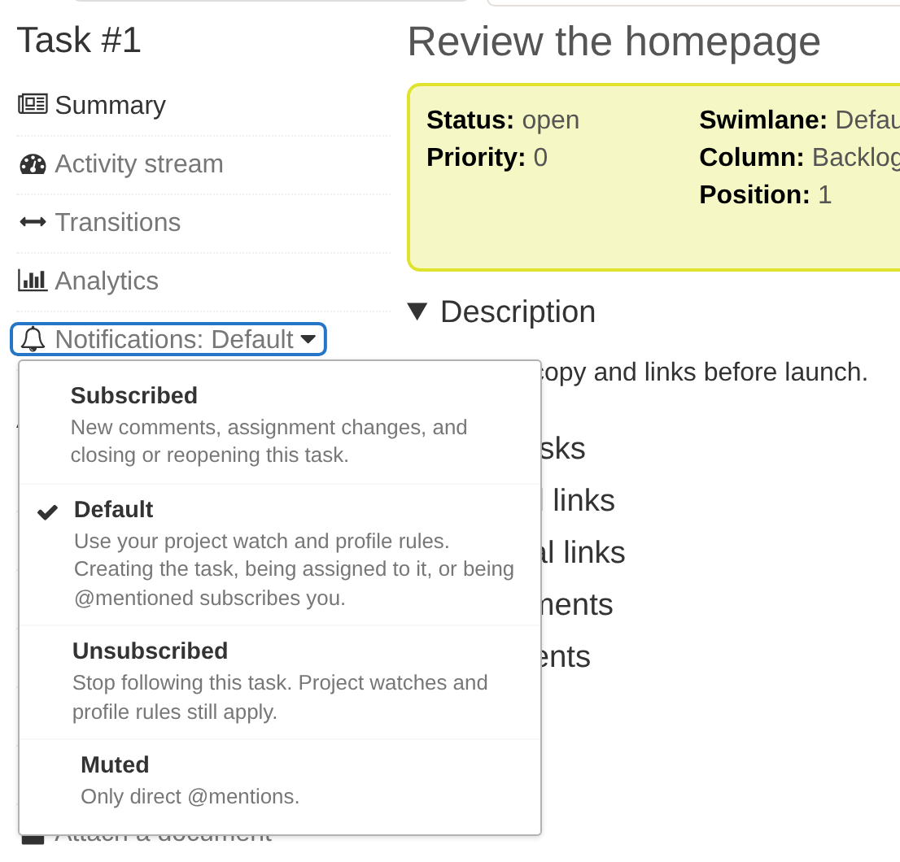

# Plan Notifications

GitHub-style task subscriptions and project watches for Plan, a Kanboard fork.

See [the project plan](PROJECT_PLAN.md) for scope, release checks, and follow-up work.

## How notifications work

In your profile’s **Notifications** settings, enable **Web** for in-app alerts, **Email**, or both. Watching, subscribing, and being mentioned do not turn on a delivery channel. Email also requires an email address on your account and a configured mail server.

Choose **No tasks by default** in that same form to turn off alerts based on your profile’s task rules. Keep a delivery channel enabled to still receive alerts for task subscriptions (including automatic subscriptions), project watches, and direct `@mentions`.

### Project and task settings

On the board, task list, or overview pages, use the bell menu after the view links (Overview, Board, List, …). A filled bell means you’re watching all activity. On a task page, use **Notifications** in the task sidebar. Both menus show a warning when your other settings change what the menu choice does (see [Warnings in the menus](#warnings-in-the-menus)).

| Where | Setting | What it does |
| --- | --- | --- |
| Project bell menu | **Participating and @mentions** (default) | You are not watching the entire project. Task subscriptions, direct mentions, and your profile’s notification rules still apply. |
| Project bell menu | **All activity** (filled bell) | Follow supported activity on every task in this project, even tasks you didn’t create or aren’t assigned to. |
| Task **Notifications** | **Default** | Clear your task-level choice. Project watching and profile rules still apply, and future activity can automatically subscribe you. |
| Task **Notifications** | **Subscribed** | Follow supported activity on this task, even if you don’t watch the project or the task doesn’t match your profile rules. |
| Task **Notifications** | **Unsubscribed** | Stop following this task and prevent automatic resubscription. **You can still get alerts through a project watch or a profile rule.** |
| Task **Notifications** | **Muted** | Stop ordinary task alerts from subscriptions, project watches, and profile rules. It also prevents automatic resubscription. Direct `@mentions` still notify you. |

**Supported activity** for a project watch or task subscription: new tasks, new comments, assignment changes, and closing or reopening a task. Other events, such as ordinary task edits, still follow your existing profile rules unless the task is muted.

**Project bell menu** — click the outlined bell next to the project’s view links.



**Task sidebar menu** — click the outlined **Notifications** row in the left sidebar.



### When Plan subscribes you automatically

You automatically subscribe to a task when you **create it**, **are assigned to it**, or **receive a direct `@mention`** in a new task description or a comment you can see, provided you’re an active member of the project (directly or through a group). Posting a comment alone does not subscribe you. Existing tasks are not backfilled when the plugin is installed. Being unassigned does not remove your subscription. **Unsubscribed** and **Muted** are remembered until you change them; choosing **Default** makes automatic subscription possible again.

### Which rule wins?

Plan only sends personal alerts to active project members with an enabled channel. It doesn’t notify you about your own actions or send you a comment you don’t have permission to see.

1. **Direct `@mention`:** Use Plan’s mention picker in a new task description or a new comment. A direct mention bypasses task mute, project watch settings, and profile filters for the alert, but it only subscribes a recipient whose task setting is **Default**. Adding a mention by editing an existing task or comment does not trigger a new mention alert or subscription.
2. **Mute:** If there’s no direct mention, a muted task sends no ordinary personal alert.
3. **Subscription or project watch:** For supported activity, either one is enough. These rules can notify you even if your profile filters only allow tasks assigned to or created by you. They do respect the profile’s **I only want to receive notifications for these projects** list: in a project outside that list, you only get direct `@mentions`.
4. **Profile rules:** If none of the above sends an alert or blocks it, Plan checks your usual task and project filters. For example, **Only for tasks assigned to me** still matches an assigned task even after you unsubscribe from it.

If several rules match the same action, you get **one alert per enabled channel**. If that action mentions you, the alert is labeled as a mention. Scheduled overdue reminders and project-wide integrations use separate settings and aren’t changed by these rules.

### Warnings in the menus

Both menus show a warning, with a link to your notification settings, when another setting changes what you’ll receive:

| Warning | What it means |
| --- | --- |
| Email and web notifications are off. | You get no alerts at all, whatever you choose in the menu. |
| Your account has no email address… | **Email** is on, but there’s no address to send to. You get only web alerts, or none if **Web** is off. |
| Your profile only allows notifications from other projects… | Your profile’s project list excludes this project. Subscriptions and project watches send nothing here; only direct `@mentions` do. |
| You watch all activity in this project… | Shown on an **Unsubscribed** task. Your project watch still sends supported alerts for it. Choose **Muted** to stop them. |
| Your profile notification rules match this task… | Shown on an **Unsubscribed** task. Your profile rules (for example **All tasks** or **Only for tasks assigned to me**) still send alerts for it. Choose **Muted** to stop them. |

The menus can’t detect everything. You also won’t get alerts if:

- The activity isn’t supported (see the list above) and your profile rules don’t match it.
- You can’t see the comment because of its visibility setting.
- An administrator hasn’t configured a mail server (email only).

### What changes when the plugin is enabled

Even before anyone uses the menus, Plan’s notifications behave differently than without the plugin:

- **Automatic subscriptions.** Creating a task, being assigned to it, or being `@mentioned` subscribes you. You then get supported alerts for that task even if your profile is set to **Only for tasks assigned to me** or **Only for tasks created by me**. Being unassigned doesn’t remove the subscription.
- **Mentions anywhere in the text.** Plan without the plugin only sends a mention alert when the mention is at the very start of a new task description or comment. With the plugin, a mention anywhere in the text sends one.
- **One alert instead of two.** Without the plugin, a mentioned user can get a mention alert and a regular alert for the same action. With the plugin, they get only the mention alert.
- **No alert about your own action without a login.** When a task or comment is created without a logged-in user (for example through the API with an application token), the task creator or comment author is not notified about their own action.
- **Late alerts are dropped.** If a task moves to another project or is deleted before a queued alert is sent, the alert is discarded.

### Disabling the plugin

Subscriptions and project watches are kept in the database, but no longer have any effect. Users who chose **No tasks by default** silently stop receiving task alerts, except direct `@mentions`, because Plan doesn’t know this option. Their profile form then shows no selection until they choose and save another option. Ask them to review their notification settings before you disable the plugin.

### Common examples

- **“I’m not watching the project. Why did I get an email?”** If you created the task, were assigned to it, or were mentioned, you may already be subscribed. Check the task sidebar.
- **“I unsubscribed. Why am I still getting emails?”** Check whether you watch the project or have a profile rule that matches the task; the task menu shows a warning if either applies. Choose **Muted** to stop ordinary alerts for just that task.
- **“I’m subscribed. Why don’t I get anything?”** Open the task’s **Notifications** menu and look for a warning. The usual causes are that both channels are off, your account has no email address, or your profile’s project list excludes this project.
- **“Why is there no link to the comment?”** An administrator must set the **Application URL** in Plan’s application settings. Once set, new-comment and comment-mention emails include a **View comment** link that jumps straight to the comment.

## Installation

`plan-docker` mounts this repository as `plugins/Notifications`. For a manual install, clone it into that same case-sensitive directory in the Plan fork. The plugin has no extra PHP dependencies and creates its own tables on startup. SQLite is covered by the integration test; MySQL and PostgreSQL migration paths are provided but not yet verified. Stock Kanboard is not currently supported.

## Development

From an isolated Plan checkout with the plugin mounted or symlinked at `plugins/Notifications`, run:

```sh
php plugins/Notifications/tests/integration.php "$PWD"
```

The test uses an in-memory SQLite database and captures outgoing email after core renders it. To also send through a local test SMTP server, set `PLAN_NOTIFICATIONS_TEST_SMTP_PORT` to its loopback port. For installations with external queue workers, follow the worker rollout instructions in the [project plan](PROJECT_PLAN.md).

### Refresh the README screenshots

On Linux, with [devenv](https://devenv.sh/) installed and the `plan` submodule initialized in `plan-docker`, run this from the plugin directory:

```sh
devenv shell -- just screenshots
```

The recipe installs the locked Playwright dependencies, exports the sibling `../plan` checkout at `HEAD`, and loads this plugin from the working tree. It seeds a demo board and task in a temporary SQLite database, starts Plan on a free loopback port, and overwrites both WebP files in `docs/screenshots/`. Both menus show their default selections. The temporary server and database are removed afterward; Docker and existing Plan data are not used.

From a standalone plugin checkout, set `PLAN_SCREENSHOT_PLAN_DIR` to a Plan Git checkout with committed vendor dependencies. To capture a running `plan-docker` instance at `http://127.0.0.1:7000/` instead, run `npm ci --prefix scripts` in the devenv shell, then `just screenshots-existing <project-id> <task-id>`. That recipe uses `admin`/`admin` unless you set `PLAN_SCREENSHOT_USER` and `PLAN_SCREENSHOT_PASSWORD`.

## Releasing

1. Set `getPluginVersion()` in `Plugin.php` to the next `X.Y.Z` and add a matching `## [X.Y.Z]` section to `CHANGELOG.md` (optionally `## [X.Y.Z] - YYYY-MM-DD`). Run the integration test against the Plan revision you intend to support.
2. Push the reviewed release commit to the `release` branch. GitHub Actions lints PHP, creates the `vX.Y.Z` tag and release, and uses only that changelog section’s body as the release notes. The attached `Notifications-X.Y.Z.zip` extracts to `Notifications/` for manual installation under Plan’s `plugins/` directory.
3. Update `plan-docker` separately to pin the released commit. Publishing a release does not change that submodule pin.

To preview the ZIP and release notes from the current **committed** snapshot, run `python3 scripts/prepare-release.py /path/to/output`. To retry a failed release, rerun the workflow on the same commit; it won’t move an existing tag or overwrite a published release.
